# Bookmark Wizard

Bookmark Wizard ist eine lokale Chrome-Erweiterung zum Suchen, Bearbeiten, Taggen und Organisieren deiner Lesezeichen. Die Bookmarks bleiben in Chrome, Tags werden separat in `chrome.storage.local` gespeichert. Kein Konto, keine Analytics und kein Upload deiner Bookmarks an einen Bookmark-Wizard-Server.

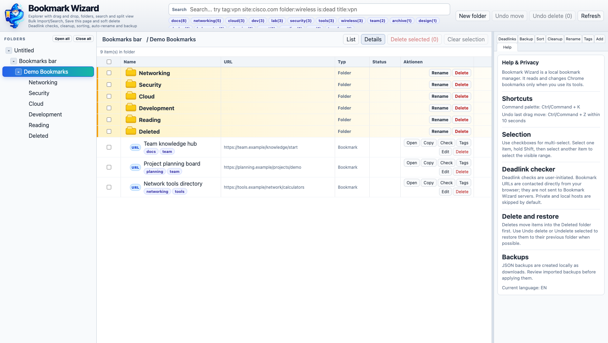

**Alle Screenshots zeigen erfundene Bookmarks.** Die `.example`-Adressen dienen ausschließlich der Demonstration. Auch die Ergebnisse der Linkprüfung sind simuliert; es wurden keine echten Bookmark-Seiten geprüft. Die Bilder wurden direkt aus der Anwendung aufgenommen.

## Installation

```bash
npm install
npm run build
```

1. Öffne `chrome://extensions` in Chrome.
2. Aktiviere den **Entwicklermodus**.
3. Klicke auf **Entpackte Erweiterung laden** und wähle den erzeugten Ordner `dist/`.
4. Öffne Bookmark Wizard über das Toolbar-Symbol. Mit **Open full view** wechselst du in die vollständige Ansicht.

Nach einem Update erneut bauen und die Erweiterung in `chrome://extensions` neu laden.

## Funktionen mit Screenshots

### Ordner, Ansichten und Mehrfachauswahl

Links navigierst du durch deine Bookmark-Ordner; in der Mitte siehst du ihren Inhalt. **Details** zeigt Name, URL, Typ beziehungsweise Pfad, Linkstatus und Aktionen. **List** bietet eine kompaktere Ansicht. Die Spaltenbreiten lassen sich am Tabellenkopf anpassen.

Mit Checkboxen wählst du mehrere Einträge aus. Halte **Shift** beim Auswählen eines zweiten Eintrags, um einen sichtbaren Bereich zu markieren. Ziehe einen ausgewählten Eintrag auf einen Ordner, um die Auswahl gemeinsam zu verschieben. **Undo move** oder **Ctrl/Command + Z** macht den letzten Drag-Move innerhalb von zehn Sekunden rückgängig.

Die Übersicht oben zeigt den Ordnerbaum, die Tag-Cloud und die Detailansicht.

### Name und URL direkt bearbeiten

Klicke in eine Bookmark-Zeile, auf ihren Namen oder auf die URL. Beide Felder werden direkt in der Zeile bearbeitbar. Sobald du etwas änderst, erscheint **Save** hinter den Feldern. Speichere mit **Save** oder **Enter**; **Cancel** oder **Escape** verwirft den Entwurf. Eine URL braucht ihr Schema, zum Beispiel `https://`.

Das funktioniert in **Details**, **List** und in Suchergebnissen. Tags bleiben am selben Bookmark erhalten. Mit **Open** öffnest du einen Link, mit **Copy** kopierst du seine URL.

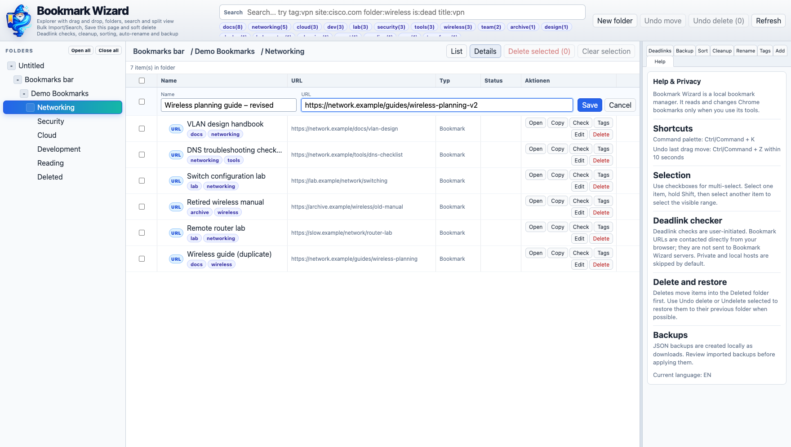

<details>
<summary>Bearbeiten über das Rechtsklickmenü</summary>

Rechtsklick auf einen Bookmark → **Edit** öffnet dieselbe Bearbeitung. Das Menü bietet außerdem **Open**, **Copy URL**, **Tags** und **Delete**. Bei Ordnern steht **Rename** zum Umbenennen bereit.

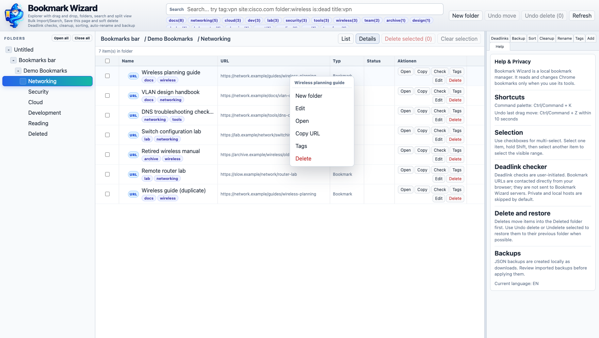

</details>

### Volltextsuche, Operatoren und Splitview

Die Suche berücksichtigt Name, URL, Ordnerpfad und Tags; Tag-Treffer werden bevorzugt. Klicke auf einen Tag in der Tag-Cloud, um danach zu suchen. Im Screenshot sucht `tag:docs` über mehrere Ordner hinweg. Die Suchergebnisse bleiben oben geöffnet, während du unten durch einen Ordner navigierst.

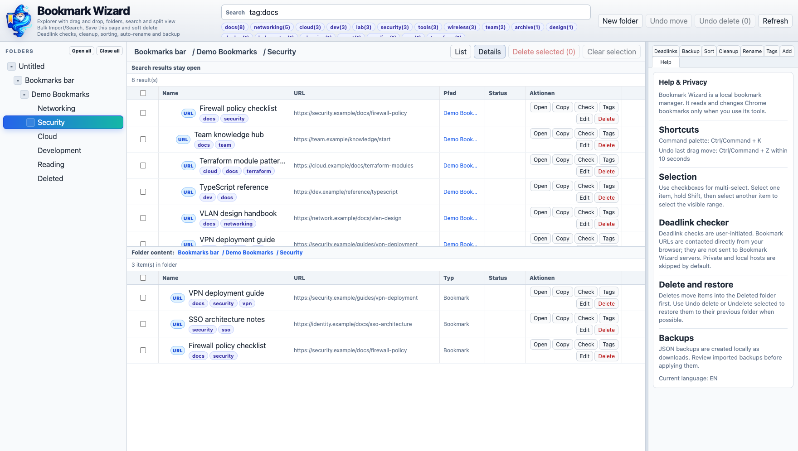

| Beispiel | Wirkung |
| --- | --- |
| `wireless` | Sucht den Begriff in Name, URL, Pfad und Tags. |
| `tag:docs` | Sucht Bookmarks mit dem passenden Tag. |
| `site:network.example` | Filtert nach Hostname. |
| `domain:network.example` | Filtert nach Domain. |
| `folder:Security` | Sucht innerhalb passender Ordnerpfade. |
| `path:Networking` | Filtert nach Pfad. |
| `url:wireless` | Sucht innerhalb der URL. |
| `title:VPN` oder `name:VPN` | Sucht innerhalb des Namens. |
| `is:404`, `is:timeout`, `is:ok` | Filtert nach vorhandenen Linkprüfungen. |

Operatoren lassen sich kombinieren, zum Beispiel `tag:docs folder:Networking`. Weitere Beispiele und Suchregeln stehen in [HELP.md](HELP.md).

### QuickSearch aus der Chrome-Toolbar

Das Toolbar-Symbol öffnet die schnelle Suche. Treffer zeigen Name, Tags, URL und Pfad; passende Textstellen werden hervorgehoben. Mit **ArrowUp** und **ArrowDown** wechselst du den aktiven Treffer, mit **Enter** öffnest du ihn. **Open full view** übernimmt die Suche in die große Ansicht.

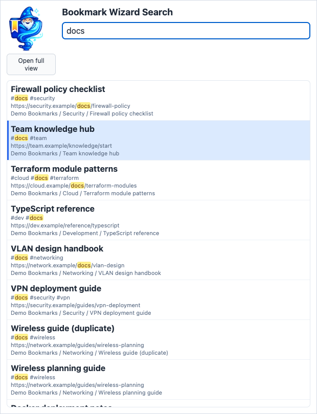

### Tags für einzelne Bookmarks und die Auswahl

Über **Tags** ergänzt, ersetzt oder entfernst du Tags. Ist der angeklickte Bookmark Teil einer Mehrfachauswahl, gilt die Bearbeitung für die ausgewählten Bookmarks. Im Screenshot erhalten zwei ausgewählte Einträge zusätzliche Tags.

Tags werden separat gespeichert und verändern den Bookmark-Titel nicht. Du kannst vorhandene Tags übernehmen und später mit `tag:` danach suchen.

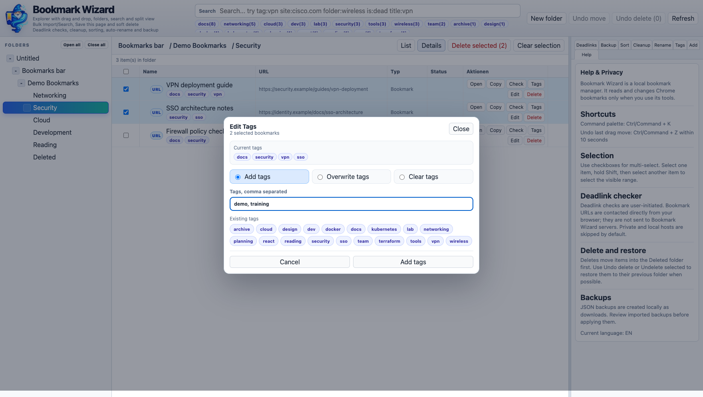

<details>
<summary>Auto Tags: Vorschläge prüfen und übernehmen</summary>

Im rechten **Tags**-Tool wählst du den Bereich, etwa den aktuellen Ordner oder alle Bookmarks, und klickst auf **Analyze tags**. Die Anwendung erzeugt lokale Vorschläge aus Name, URL, Ordnerpfad und bekannten Tags. Passe die Vorschläge an und übernimm die Auswahl mit **Apply selected**.

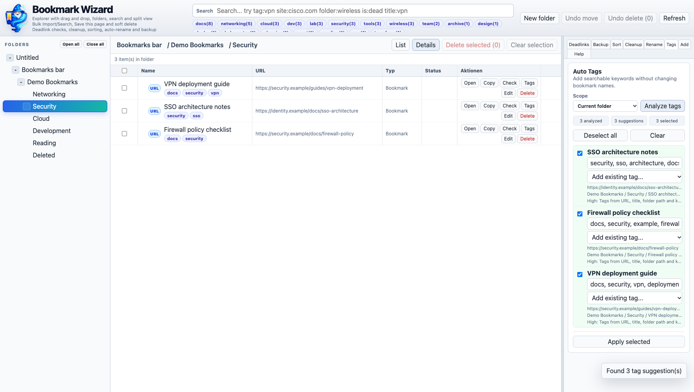

</details>

### Linkprüfung mit Status und Filtern

Unter **Deadlinks** prüfst du ausgewählte Bookmarks, den aktuellen Ordner oder alle Bookmarks. Die Erweiterung fragt die optionalen HTTP/HTTPS-Berechtigungen beim Aktivieren der Linkprüfung ab. Danach kontaktiert Chrome die Zielseiten direkt; die Prüfung startet nur auf deine Aktion. Private und lokale Hosts werden standardmäßig übersprungen, der Timeout lässt sich anpassen.

Die Tabelle zeigt beispielsweise **OK 200**, **HTTP 404** oder **Timeout**. Über die Filter grenzt du die Ergebnisse ein. **Delete scanned 404** beziehungsweise **Delete scanned timeouts** verschiebt die betreffenden Bookmarks nach Bestätigung nach `Deleted`.

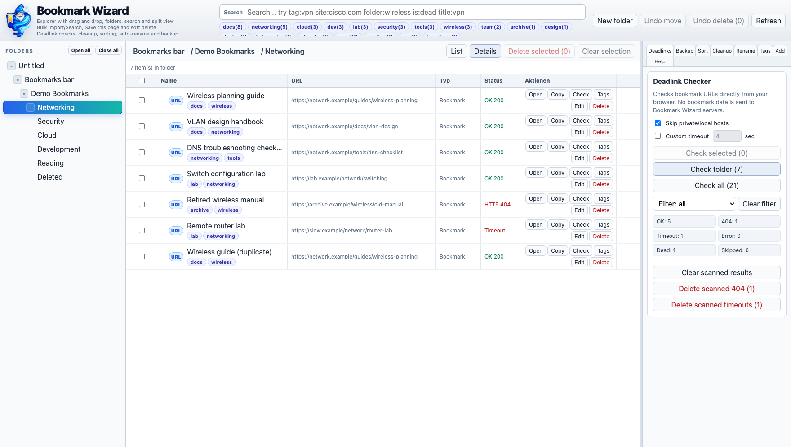

### Cleanup: Dubletten und auffällige Einträge prüfen

**Cleanup → Run scan** sucht doppelte URLs und einfache Domain-Einträge, die zur Überprüfung vorgeschlagen werden. Bereits ermittelte tote Links werden ebenfalls berücksichtigt. Prüfe die gruppierten Funde und wähle gezielt aus, was gelöscht oder mit **Dismiss selected** aus der Ergebnisliste entfernt werden soll. Ein Scan verändert noch keine Bookmarks.

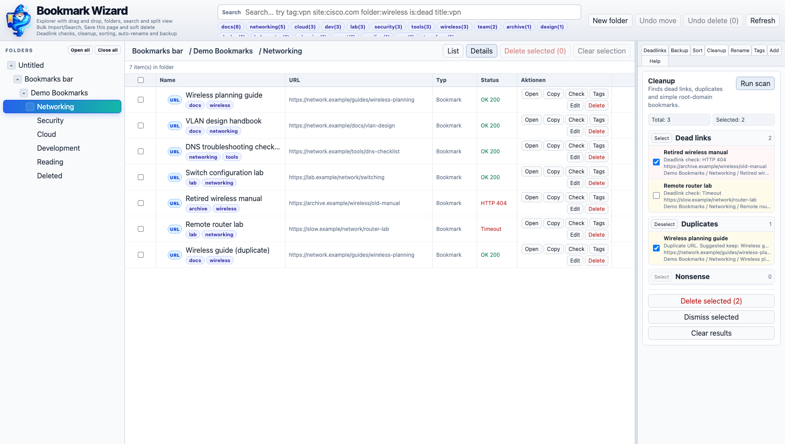

### Sortieren und Namen vereinheitlichen

**Sort → Analyze** schlägt Ordnergruppen anhand gemeinsamer Domains und Themen vor. Die Vorschau zeigt die betroffenen Bookmarks und den geplanten Zielordner. Passe den Ordnernamen und die Auswahl an, bevor du **Apply preview** oder **Apply selected** nutzt. Die Option **Backup before apply** erstellt vorher ein lokales Backup.

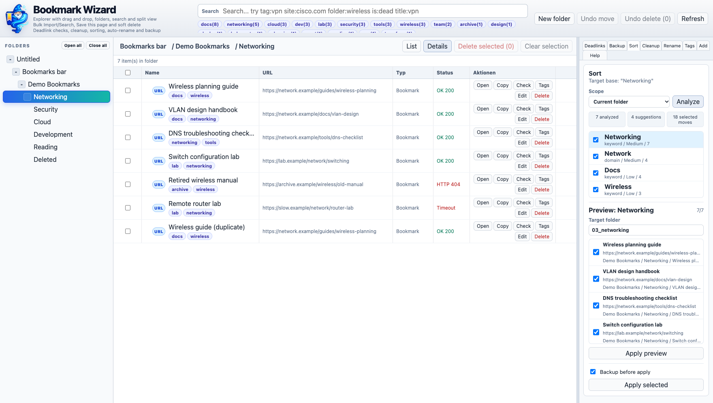

<details>
<summary>Auto Renamer: Namensvorschläge und Varianten</summary>

**Rename → Analyze names** erzeugt Namensvorschläge aus Domain und URL-Pfad. Du kannst die vorgeschlagenen Namen bearbeiten und gegebenenfalls über den Variantenregler eine andere Form wählen. Erst **Apply selected** übernimmt die ausgewählten Änderungen; **Backup before apply** ist ebenfalls verfügbar.

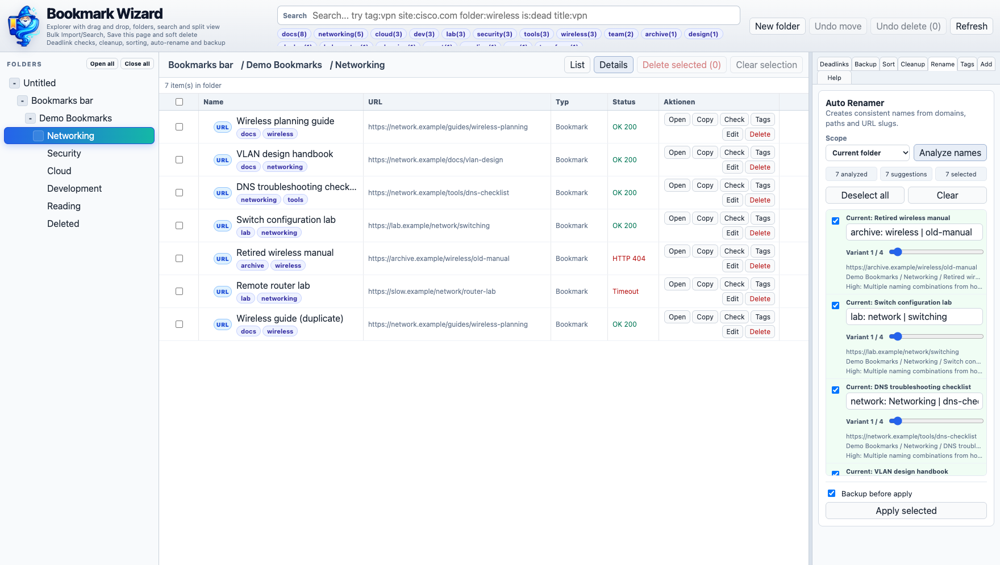

</details>

### Backups exportieren und vor dem Import prüfen

**Backup → Export JSON** lädt ein lokales Backup der Bookmark-Struktur einschließlich Tags herunter. **Import JSON** liest eine Datei ein und zeigt vor dem Übernehmen eine Importvorschau. Mit **Import into current folder** wird ein neuer Importordner angelegt; bestehende Bookmarks werden ergänzt. Tags werden auf die neu angelegten Bookmark-IDs übertragen.

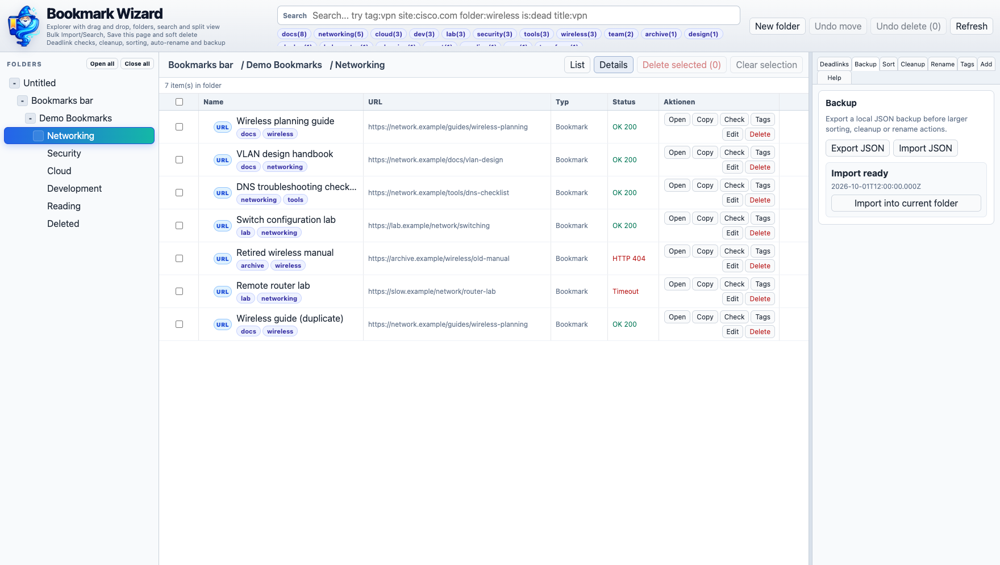

### Gelöschte Bookmarks wiederherstellen

Löschen verschiebt Bookmarks zunächst in den Ordner **Deleted**. **Undo delete** stellt den letzten Löschvorgang wieder her. Alternativ öffnest du **Deleted**, markierst Einträge und klickst auf **Undelete selected**, um sie möglichst in ihren ursprünglichen Ordner zurückzulegen.

**Löschen innerhalb von Deleted ist endgültig.** Der Screenshot zeigt einen fiktiven gelöschten Bookmark mit aktiver Wiederherstellungsaktion.

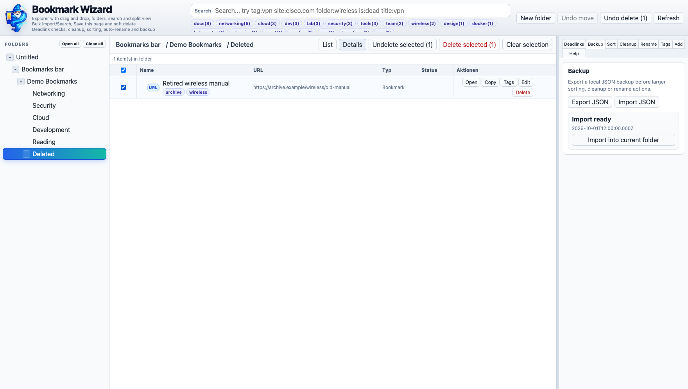

### Mehrere URLs auf einmal importieren

Unter **Add** fügst du mehrere URLs ein, wählst einen Zielordner und prüfst die Vorschau. Fehlende Protokolle werden zu `https://` ergänzt. Du kannst die Namen vor dem Import bearbeiten oder **Smart naming suggestions** aktivieren. Erst **Import** legt die Bookmarks an.

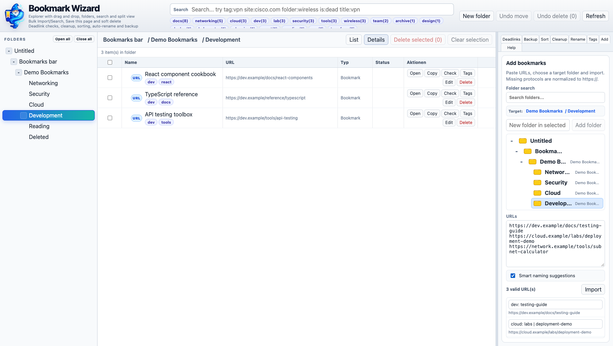

## Demo-Daten und Screenshots

Die [Demo-Backupdatei](docs/demo-bookmarks.json) enthält ausschließlich fiktive Bookmarks und Tags. Die [Anleitung zum Erstellen der Screenshots](docs/screenshots/README.md) beschreibt die isolierte Demo-Aufnahme und das zugehörige Skript.

## Entwicklung und weitere Dokumentation

```bash
npm run dev
npm run build
```

- [Hilfe auf Englisch und Deutsch](HELP.md)
- [Datenschutz](PRIVACY.md)
- [Sicherheit](SECURITY.md)
- [Hinweise zur Chrome-Web-Store-Einreichung](STORE_SUBMISSION.md)

History-Statistiken sind für eine spätere Version geplant.
