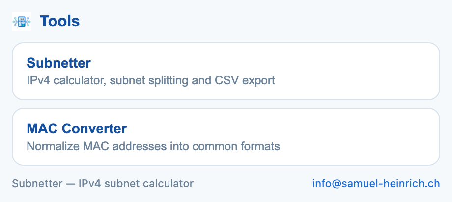
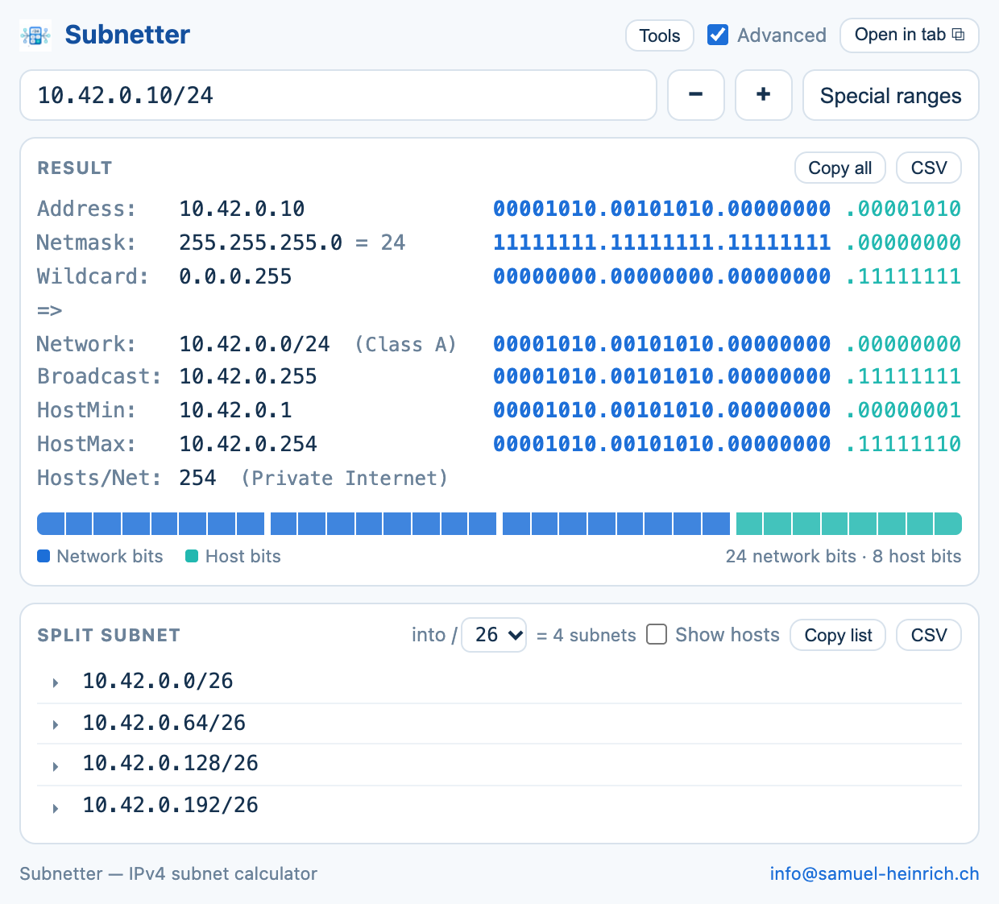
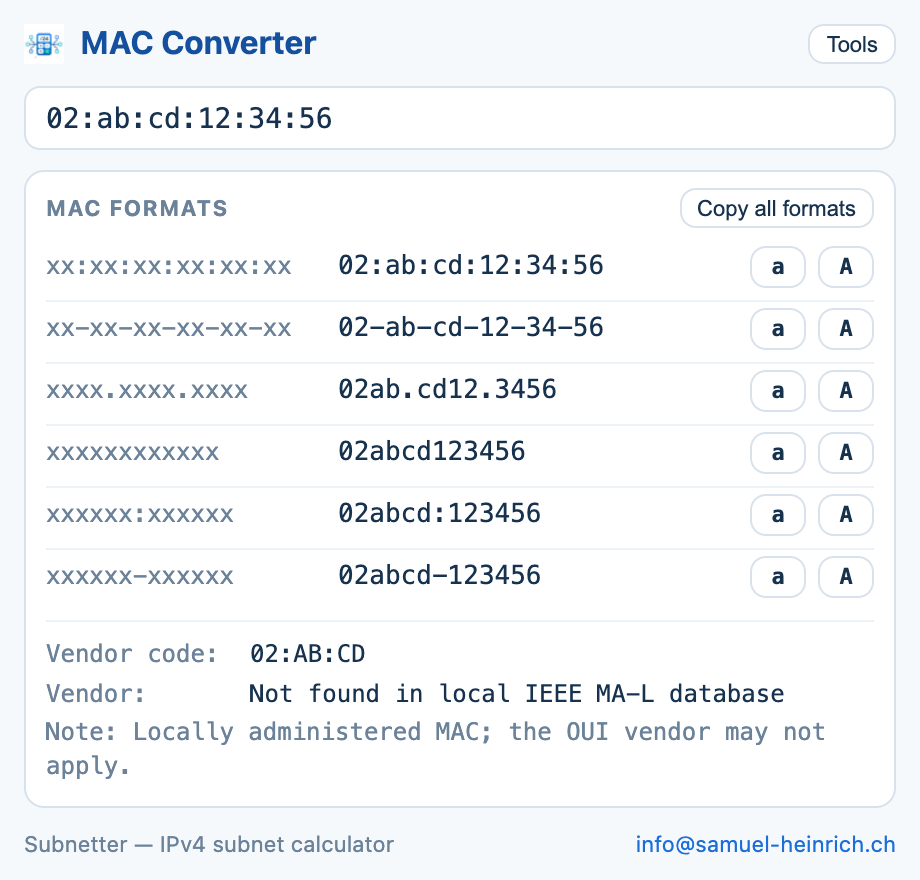

# Subnetter Tools

Eine Chrome-Erweiterung mit zwei Werkzeugen für den Netzwerkalltag: **Subnetter** berechnet IPv4-Netze und teilt sie in kleinere Subnetze auf. **MAC Converter** vereinheitlicht MAC-Adressen und sucht den Hersteller in einer mitgelieferten OUI-Datenbank.

Version **1.1.0** · Manifest V3 · Oberfläche auf Englisch · keine zusätzlichen Bibliotheken zur Laufzeit.

## Download und Installation

[**Installationspaket herunterladen · subnetter-tools-1.1.0.zip**](https://github.com/samuelheinrich/chrome-extensions/raw/refs/heads/main/extensions/subnetter/dist/subnetter-tools-1.1.0.zip)

Die ZIP enthält alle benötigten Dateien und eine deutsche [ANLEITUNG.txt](ANLEITUNG.txt). Zum Installieren sind weder Node.js noch Python nötig.

1. Die ZIP vollständig entpacken: unter Windows mit **Alle extrahieren**, unter macOS per Doppelklick.
2. Den entpackten Ordner `subnetter-tools-1.1.0` an einem dauerhaften Ort ablegen. In diesem Ordner muss `manifest.json` liegen.
3. In Chrome `chrome://extensions` öffnen.
4. Oben rechts **Entwicklermodus / Developer mode** einschalten.
5. **Entpackte Erweiterung laden / Load unpacked** anklicken und den Ordner `subnetter-tools-1.1.0` auswählen.
6. Im Puzzle-Menü von Chrome **Subnetter Tools** mit der Stecknadel anheften und über das Symbol öffnen.

Den Installationsordner anschliessend behalten: Chrome verwendet die Dateien direkt von dort. Die ZIP selbst lässt sich über **Load unpacked** nicht laden. Die Schritte entsprechen der [offiziellen Chrome-Anleitung](https://developer.chrome.com/docs/extensions/get-started/tutorial/hello-world#load-unpacked).

Wer das Repository klont oder als ZIP entpackt, kann stattdessen direkt den Ordner `extensions/subnetter` laden. Bei verwalteten Firmenbrowsern kann die IT die lokale Installation einschränken.

## Beispiel-Screenshots

Die folgenden Abbildungen zeigen die vorhandene Oberfläche mit **fiktiven Beispieldaten**. IP- und MAC-Adressen stehen für erfundene Netze und Geräte; es sind keine Aufnahmen eines tatsächlichen Kundennetzwerks. Die Oberfläche wurde für die Dokumentation im Browser gerendert.

### Werkzeugauswahl

Beim Öffnen stehen Subnetter und MAC Converter zur Auswahl. Enthält die Zwischenablage bereits eine gültige MAC-Adresse, kann die Erweiterung direkt zum MAC Converter wechseln.



### Subnetter mit Binäransicht und Netzaufteilung

Das fiktive Beispiel `10.42.0.10/24` zeigt Netzadresse, Netzmaske, Wildcard, Broadcast und Hostbereich. **Advanced** ergänzt die Binärdarstellung. **Split subnet** teilt das `/24` in vier `/26`-Netze auf.



### MAC Converter

Die fiktive, lokal administrierte Adresse `02:ab:cd:12:34:56` wird in sechs Schreibweisen ausgegeben. Der Hinweis zur lokalen Administration erklärt, warum sich daraus kein verlässlicher Gerätehersteller ableiten lässt.



## IPv4-Subnetter

### Eingaben und Ergebnisse

| Eingabe | Beispiel | Verhalten |
| --- | --- | --- |
| IPv4 mit CIDR-Präfix | `192.168.1.10/24` | Berechnet das zugehörige Netz, auch wenn eine Hostadresse eingegeben wird. |
| IPv4 mit dezimaler Netzmaske | `10.42.0.10 255.255.255.0` | Akzeptiert zusammenhängende Maskenbits. |
| IPv4 ohne Maske | `10.42.0.10` | Verwendet eine klassenbasierte Standardmaske; für eindeutige Ergebnisse das Präfix angeben. |

Die Ausgabe aktualisiert sich während der Eingabe. Sie enthält Adresse, Netzmaske, Wildcard, Netzadresse, Broadcast, erste und letzte Hostadresse sowie die Zahl nutzbarer Hosts. `/31` wird als Punkt-zu-Punkt-Netz mit zwei Hosts behandelt; `/32` als einzelner Host. Beide haben hier keinen Broadcast.

- Ein Klick auf einen Ergebniswert kopiert ihn; **Copy all** kopiert den gesamten Ergebnisblock.
- **CSV** exportiert das berechnete Netz.
- **+ / −** sowie die Pfeiltasten **↑ / ↓** ändern das Präfix.
- **Advanced** zeigt Netzwerk- und Hostbits farbig, ergänzt eine 32-Bit-Leiste und Angaben zu Adressklasse und Bereich.
- **Special ranges** zeigt eine Übersicht unter anderem zu privaten Netzen, Loopback, Link-Local, Multicast, CGNAT sowie Dokumentations- und Testnetzen.
- **Open in tab** öffnet den Rechner in einem eigenen Browser-Tab für grössere Ausgaben.

### Subnetze aufteilen

Unter **Split subnet** ein längeres Zielpräfix wählen, beispielsweise `/24 → /26`. Die Liste enthält dann vier kleinere Netze. Einzelne Netze lassen sich für weitere Details aufklappen.

**Show hosts** wechselt in eine Tabellenansicht: bis zu acht nutzbare Hosts pro Subnetz erscheinen als einzelne Spalten. Bei grösseren Netzen zeigt die Tabelle `HostMin`, `HostMax` und `Hosts`. **Copy list** kopiert dann tabulatorgetrennte Werte für Tabellenkalkulationen; **CSV** exportiert die Tabelle. Ohne **Show hosts** kopiert **Copy list** die CIDR-Netze zeilenweise.

Eine Aufteilung ist auf **4'096 Subnetze** begrenzt. Grössere Ergebnisse werden mit einem Hinweis abgefangen.

### Rechenbeispiel

Für `192.168.1.10/24` ergibt sich:

| Wert | Ergebnis |
| --- | --- |
| Netzwerk | `192.168.1.0/24` |
| Netzmaske | `255.255.255.0` |
| Wildcard | `0.0.0.255` |
| Broadcast | `192.168.1.255` |
| Erste / letzte Hostadresse | `192.168.1.1` / `192.168.1.254` |
| Nutzbare Hosts | `254` |

## MAC Converter

Diese Schreibweisen werden erkannt und in alle sechs Formate umgewandelt:

| Format | Fiktives Beispiel |
| --- | --- |
| Doppelpunkte | `02:ab:cd:12:34:56` |
| Bindestriche | `02-ab-cd-12-34-56` |
| Vierergruppen mit Punkten | `02ab.cd12.3456` |
| Ohne Trennzeichen | `02abcd123456` |
| Zwei Sechsergruppen mit Doppelpunkt | `02abcd:123456` |
| Zwei Sechsergruppen mit Bindestrich | `02abcd-123456` |

Die Schaltflächen **a** und **A** kopieren die jeweilige Schreibweise in Klein- oder Grossbuchstaben. **Copy all formats** kopiert alle Varianten zeilenweise.

Beim Öffnen des Popups und beim Wechsel zum MAC Converter liest die Erweiterung die Zwischenablage. Wird dort eine gültige MAC-Adresse erkannt, übernimmt sie diese automatisch; andere Inhalte werden ignoriert.

Die Herstellerabfrage vergleicht die ersten 24 Bits mit der lokal gebündelten **IEEE MA-L OUI-Datenbank** in [`oui-vendors.js`](oui-vendors.js). Zur Laufzeit ist dafür keine Netzwerkanfrage nötig. Fehlende Einträge werden als nicht gefunden angezeigt. Bei lokal administrierten Adressen erscheint ein zusätzlicher Hinweis. Die Datenbank bildet den gebündelten Stand ab und aktualisiert sich nicht automatisch.

## Berechtigungen und gespeicherte Daten

| Berechtigung | Verwendung |
| --- | --- |
| `storage` | Speichert letzte IPv4- und MAC-Eingaben sowie Anzeige- und Aufteilungsoptionen lokal über `chrome.storage.local`. |
| `clipboardRead` | Liest die Zwischenablage zur automatischen Übernahme gültiger MAC-Adressen. |

Berechnungen und Herstellerabfragen erfolgen lokal. Das Manifest fordert keine Berechtigungen für besuchte Websites an. Kopierbuttons schreiben die ausgewählten Ergebnisse in die Zwischenablage; CSV-Dateien werden lokal erzeugt.

## Aktualisieren und Entfernen

Für ein Update die Dateien im bisherigen Installationsordner ersetzen und unter `chrome://extensions` bei **Subnetter Tools** auf **Neu laden** klicken. Zum Deinstallieren dort **Entfernen** auswählen.

## Entwicklung und ZIP-Build

Die Erweiterung besteht aus HTML, CSS und JavaScript. Sie benötigt keine npm-Abhängigkeiten und keinen Kompilierungsschritt.

Aus dem Repository-Hauptordner:

```sh
# IPv4-Tests ausführen; benötigt Node.js
node --test extensions/subnetter/test/ipcalc.test.js

# JavaScript-Syntax prüfen
node --check extensions/subnetter/ipcalc.js
node --check extensions/subnetter/popup.js
node --check extensions/subnetter/oui-vendors.js

# Versandpaket erzeugen; benötigt Python 3
python3 extensions/subnetter/build.py
```

Der Build liest die Versionsnummer aus `manifest.json` und schreibt `extensions/subnetter/dist/subnetter-tools-<version>.zip`. Das Paket enthält ausschliesslich Laufzeitdateien, Icons und `ANLEITUNG.txt`; Tests, Dokumentation und Screenshots bleiben im Repository. Alle ZIP-Einträge liegen in einem gemeinsamen Ordner, den der Empfänger nach dem Entpacken direkt in Chrome laden kann.

Die vorhandenen Tests prüfen unter anderem Eingabeformate, ungültige Masken, Hostadressen innerhalb eines Netzes, `/0`, `/31`, `/32`, Subnetzaufteilung und Binärdarstellung.

### Dateien

| Pfad | Zweck |
| --- | --- |
| `manifest.json` | Name, Version, Popup und Chrome-Berechtigungen |
| `popup.html`, `popup.css`, `popup.js` | Oberfläche, Interaktionen, MAC-Konvertierung und Export |
| `ipcalc.js` | IPv4-Berechnung ohne DOM-Abhängigkeit |
| `oui-vendors.js` | Gebündelte Herstellerdatenbank |
| `icons/` | Erweiterungssymbole |
| `test/ipcalc.test.js` | Tests der IPv4-Berechnung |
| `ANLEITUNG.txt` | Deutsche Anleitung für Empfänger der ZIP |
| `build.py`, `dist/` | Paketbau und versandfertige ZIP |
| `docs/screenshots/` | Beispiel-Screenshots für dieses README |

Kontakt: [info@samuel-heinrich.ch](mailto:info@samuel-heinrich.ch)
